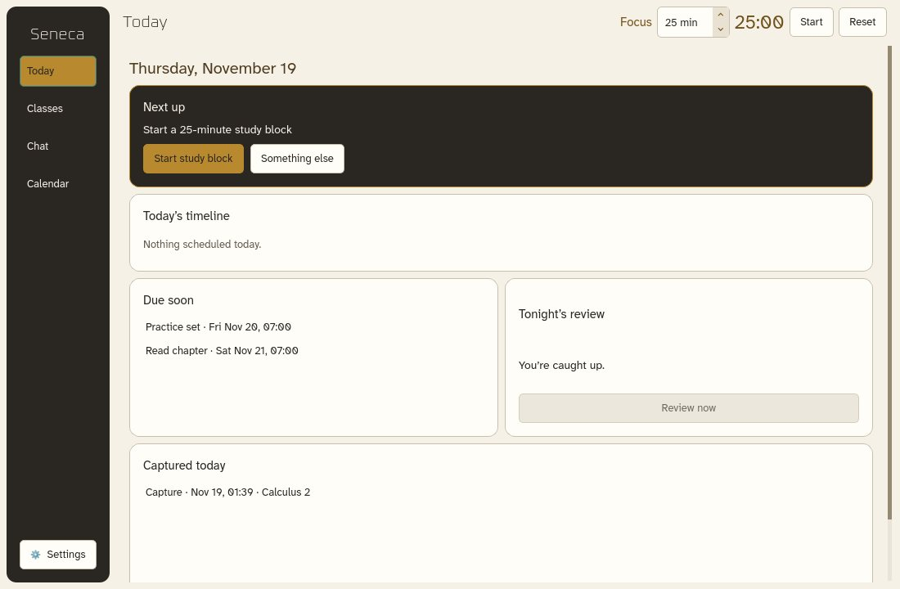

# Seneca

- See what to study next alongside your classes, deadlines, and review queue.
- Ask a question from the desktop companion or continue in Home.
- Save class notes and captures, and bring difficult material back for review.

## Download

[Download v0.15.0-beta.1](https://github.com/sebasnyc/project-seneca-downloads/releases/tag/v0.15.0-beta.1) is a manual pre-release install.

[Latest stable release for Windows and Mac](https://github.com/sebasnyc/project-seneca-downloads/releases/latest) · [All releases](https://github.com/sebasnyc/project-seneca-downloads/releases)

**Windows 11 x64.** Choose Setup.exe to install or the complete Portable.zip to run without installing.

**macOS 14 or newer.** Choose arm64 for Apple Silicon or x86_64 for Intel. Expand the ZIP and move Seneca.app to Applications.

Seneca saves study data on your device. You review the text before sending a cloud tutor request.

[Release history](CHANGELOG.md) · [License](LICENSE.md) · [Artwork and credit](NOTICE.txt)
